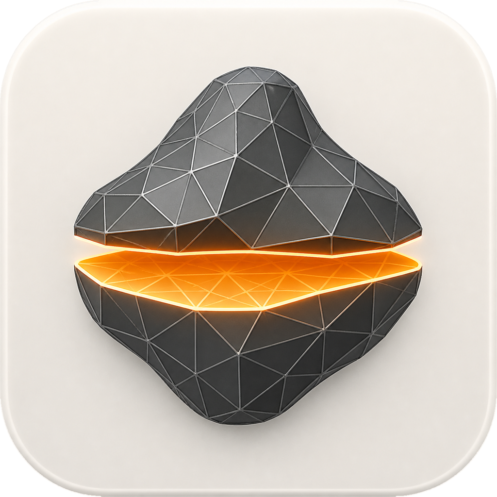
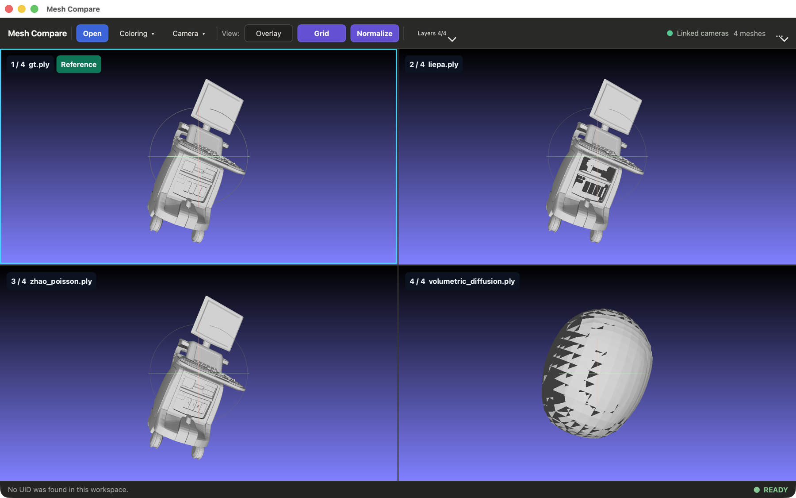
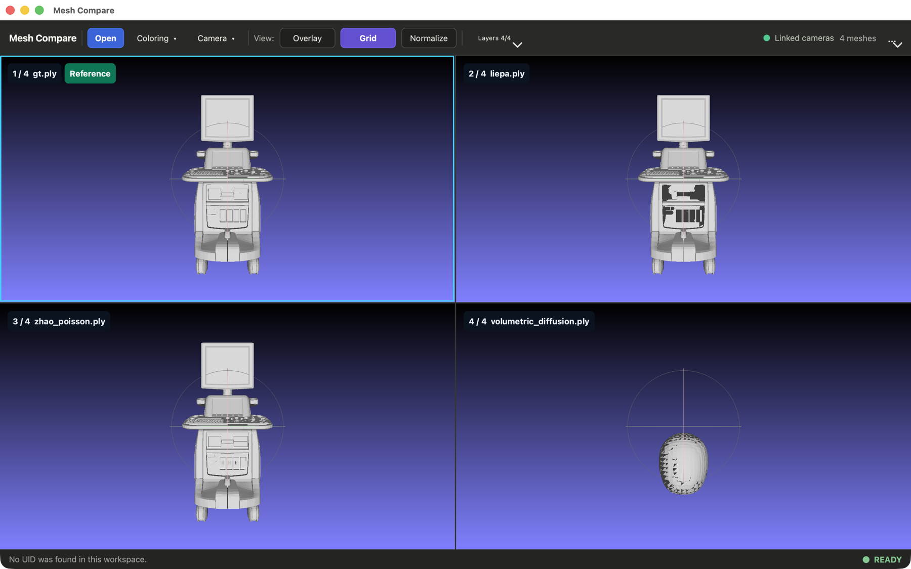
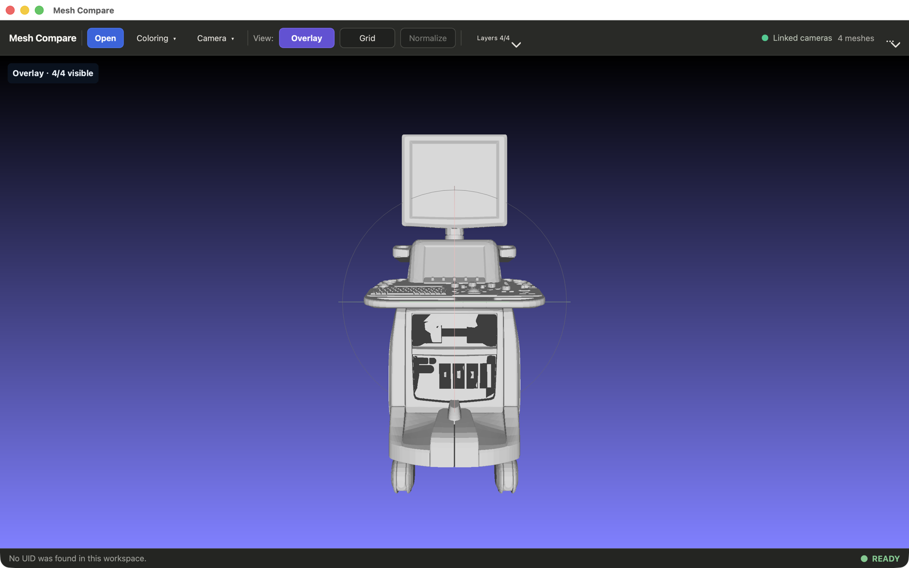

<div align="center">
  
  <h1>Mesh Compare</h1>
  <p>A focused macOS workspace for visual and quantitative mesh comparison.</p>
</div>



## Highlights

- Open any number of meshes or a multi-layer MeshLab project, and choose up to
  **8 visible layers** at a time.
- Compare meshes in a **linked camera grid** or a single **overlay view**.
- **Normalize** every Grid mesh independently for easier shape comparison.
- Run **Distance to Reference** and **Double Layer** analyses with color overlays.
- Choose the Reference mesh, assign uniform colors, and control layer visibility.
- View original vertex and face colors, material base colors, and texture images.
- Force **double-sided rendering** for open or inconsistently wound surfaces.
- Save reusable camera poses with tags, notes, and screenshots.
- Render comparison grids from the command line.

## Views

| Linked Grid | Overlay |
|:--:|:--:|
|  |  |
| Inspect each mesh in its own synchronized viewport. | Inspect all visible layers in one viewport. |

## Quick Start

Open files from Finder, drag them into the window, or use **Open** in the
toolbar. Supported mesh formats are `.obj`, `.ply`, `.stl`, `.off`, and
embedded `.glb`. Opening more files adds their layers to the current workspace,
preserving the existing meshes, Reference, selection, colors, and camera.

All imported layers remain available in **Layers**. Mesh Compare initially shows
all layers when there are eight or fewer, and the first eight for larger imports.
Later imports fill any remaining visible slots, keeping the current selection
of visible layers. Additional layers start hidden.
Use **Layers** to choose any 1–8 layers in either view. A notice shows the visible
and total layer counts whenever some layers are hidden, and updates as the
selection changes.
When 8 are already visible, uncheck a layer before selecting another.

```bash
# Open one or more meshes
open build/dist/meshcompare.app --args reference_gt.obj candidate.obj

# Open one MeshLab project
open build/dist/meshcompare.app --args comparison.mlp
```

The first mesh whose name contains `gt` becomes the initial Reference. If no
mesh matches, Mesh Compare uses the first imported mesh.
Later imports keep the current Reference.

Meshes initially display their imported colors and textures. **Uniform Color**
and analysis results temporarily override that appearance; **Clear Coloring**
restores it. Models without color data use the usual gray shading.
GLB base-color materials and textures are supported; metallic/roughness,
normal-map, and other physically based shading effects are not reproduced.
Transparent surfaces use basic alpha blending; glTF alpha cutoffs and sorting
of overlapping transparent faces are not reproduced.

In **Camera**, enter tags and an optional note in the capture form, then click
**Save View** to save them together with the viewpoint and screenshot.
To edit a saved view, select it, change its tags and note, and click
**Save Changes** once for the entire form. The same form is available beside
the image in **Browse**, including views from other workspaces. Notes support
multiple lines and are stored with the view in the camera JSON library.
**Apply View** restores the selected camera position. Browse stays open without
blocking the Camera panel or model controls.

## Build

Requirements: CMake 3.18+, Qt 5.15, a C++ toolchain, and the platform OpenGL
SDK. MeshLab/VCGLib sources are vendored in `third_party/`.

```bash
cmake -S . -B build \
  -DCMAKE_BUILD_TYPE=Release \
  -DCMAKE_PREFIX_PATH=/path/to/Qt/5.15
cmake --build build --target meshcompare --parallel
```

The macOS bundle is written to:

```text
build/dist/meshcompare.app
```

Run the test suite with:

```bash
cmake -S . -B build -DBUILD_TESTING=ON
cmake --build build --parallel
ctest --test-dir build --output-on-failure
```

## Batch Rendering

Render an `.mlp` project to a PNG without opening the application window:

```bash
build/dist/meshcompare.app/Contents/MacOS/meshcompare \
  --render-grid comparison.mlp \
  --output-dir ./renders \
  --size 2048x1152 \
  --coloring distance
```

Use `meshcompare --help` for camera, saved-pose, coloring, and output options.

## Architecture

Mesh Compare owns its workspace, UI, analysis, camera library, and diagnostics.
The vendored MeshLab viewport engine is isolated behind a renderer adapter; the
legacy MeshLab window, docks, filters, and editing tools are not packaged.

See [docs/architecture.md](docs/architecture.md) for implementation details.

## License

See [LICENSE.txt](LICENSE.txt).
